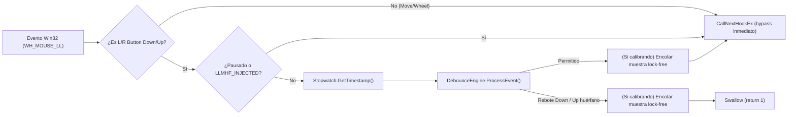

# MouseDebounceFix

Utilidad ligera y de código abierto para Windows (System Tray) escrita en **C# (.NET 8)** que elimina el **switch chatter** (doble o triple clic involuntario por rebote mecánico del microswitch del mouse) mediante un algoritmo de **eager debouncing**.

## ¿Cómo funciona?

Cuando un microswitch físico se desgasta, la lámina metálica interna vibra al soltar o presionar el botón, generando pulsos fantasma en menos de 70 ms. **MouseDebounceFix** intercepta únicamente los eventos de botón izquierdo y derecho mediante `SetWindowsHookEx(WH_MOUSE_LL)` con **latencia cero en el clic legítimo**:



### Decisiones clave de ingeniería

- **Eager debouncing sin latencia añadida**: el primer `Down` pasa de inmediato. Solo se descartan los `Down` que llegan demasiado pronto después del último `Up` (por defecto `< 65 ms`) junto con su `Up` huérfano correspondiente, sin romper *Drag & Drop* ni dobles clics humanos normales (130–250 ms).
- **Ventana deslizante ante ráfagas (triple rebote)**: los `Up` fantasma suprimidos también actualizan la marca temporal de liberación para bloquear cadenas consecutivas de rebotes hasta que el contacto mecánico se estabilice.
- **Reloj monotónico (`Stopwatch.GetTimestamp`)**: inmune a saltos o sincronizaciones NTP del reloj del sistema.
- **Respeto a eventos inyectados (`LLMHF_INJECTED`)**: ignora clics generados por escritorio remoto (RDP), accesibilidad o scripts de automatización.
- **Callback ultrarrápido y seguro**: sin I/O, sin logging síncrono ni acceso a UI dentro del hook (`WH_MOUSE_LL`), evitando que Windows desenganche el hook por `LowLevelHooksTimeout`. El delegado nativo permanece referenciado en un campo de instancia para evitar recolección por el GC.
- **Atajo de pánico global (`Ctrl + Alt + Shift + X`)**: implementado con `RegisterHotKey` (sin instalar un hook de teclado) para cerrar la aplicación y liberar el hook al instante ante cualquier emergencia.
- **Instancia única**: garantizada mediante `Mutex` (`Local\MouseDebounceFix_SingleInstance_Mutex`).

## Estructura del proyecto

```text
MouseDebounceFix/
├── MouseDebounceFix.sln
├── src/
│   ├── MouseDebounceFix.csproj
│   ├── Core/
│   │   ├── DebounceEngine.cs         # Lógica pura de eager debouncing (sin APIs de Windows)
│   │   ├── AppSettings.cs            # Persistencia atómica en JSON (%LocalAppData%)
│   │   └── CalibrationTracker.cs     # Cola lock-free acotada para telemetría en vivo
│   ├── Native/
│   │   ├── LowLevelMouseHook.cs      # P/Invoke WH_MOUSE_LL + LLMHF_INJECTED + IDisposable
│   │   └── GlobalEmergencyHotkey.cs  # Atajo de emergencia Ctrl+Alt+Shift+X (RegisterHotKey)
│   ├── UI/
│   │   ├── TrayAppContext.cs         # System Tray, menú contextual y contador en vivo
│   │   ├── CalibrationForm.cs        # Ventana de calibración en tiempo real
│   │   └── TrayIconFactory.cs        # Íconos vectoriales dinámicos con liberación DestroyIcon
│   └── Program.cs                    # Punto de entrada con Mutex y limpieza garantizada
└── tests/
    ├── MouseDebounceFix.Tests.csproj
    ├── DebounceEngineTests.cs        # Tests de clics limpios, rebotes, triple rebote y drag-and-drop
    ├── AppSettingsTests.cs           # Tests de persistencia JSON y recuperación ante corrupción
    └── CalibrationTrackerTests.cs    # Tests de buffer lock-free y cálculo de umbral sugerido
```

## Compilar y probar desde código fuente

Requisitos: **Windows 10/11** y **.NET 8 SDK**.

```powershell
# Ejecutar toda la suite de pruebas unitarias
dotnet test

# Compilar en modo Release
dotnet build -c Release

# Publicar en un único ejecutable ligero (requiere .NET 8 Desktop Runtime)
dotnet publish src/MouseDebounceFix.csproj -c Release -r win-x64 --self-contained false /p:PublishSingleFile=true
```

El ejecutable generado quedará en:
`src/bin/Release/net8.0-windows/win-x64/publish/MouseDebounceFix.exe`

## Calibración con tu mouse real

Puedes abrir la ventana de calibración de dos formas:
1. Desde el menú del ícono en la bandeja del sistema (**Modo de calibración en vivo...**) o haciendo doble clic en el ícono.
2. Lanzando el ejecutable con el flag `--calibrate` (o `-c`):

```powershell
.\MouseDebounceFix.exe --calibrate
```

Haz clics normales y dobles clics en cualquier ventana para observar el intervalo exacto `UP → DOWN` en milisegundos de tu microswitch. La aplicación calcula automáticamente un **umbral sugerido** (`rebote máximo + 15 ms`, redondeado a múltiplos de 5 ms) que puedes aplicar con un clic y se guarda en `%LocalAppData%\MouseDebounceFix\settings.json`.

## Inicio automático y soporte para ventanas como Administrador

Por seguridad de Windows (UIPI), un hook `WH_MOUSE_LL` ejecutado sin privilegios elevados no puede filtrar clics sobre ventanas abiertas como Administrador (Visual Studio elevado, Administrador de tareas, instaladores).

Para iniciar automáticamente con soporte completo:

1. Abre el **Programador de tareas** (`taskschd.msc`) y elige **Crear tarea...** (no "Tarea básica").
2. En **General**:
   - Nombre: `MouseDebounceFix`
   - Marca **Ejecutar con los privilegios más altos**.
3. En **Desencadenadores**:
   - Nuevo → **Al iniciar sesión** (tu usuario).
4. En **Acciones**:
   - Nuevo → **Iniciar un programa** → selecciona la ruta de `MouseDebounceFix.exe`.
5. En **Condiciones**:
   - Desmarca *Iniciar la tarea solo si el equipo está conectado a la corriente alterna* (importante en laptops).
6. En **Configuración**:
   - Desmarca *Detener la tarea si se ejecuta durante más de...*.
